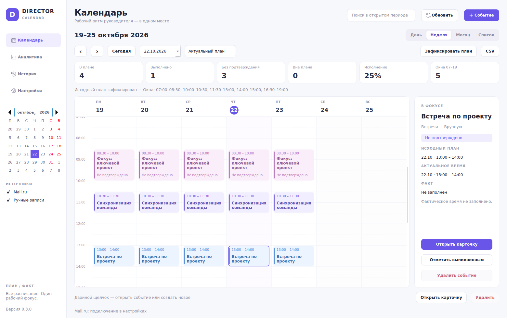

# Director Calendar — версия 0.3.5

Исправление 0.3.5: правая карточка события имеет фиксированную ширину 280 пикселей. Выбор событий с разной длиной названия, комментария и интервала больше не меняет ширину календаря. Перенос текста и скрытие правой панели на небольшом окне сохраняются.

Версия 0.3.4: для «Частично» установлен жёлтый фон с тёмной золотистой подписью, для «Перенесено» — синий цвет. Цвета едины для карточек календаря, контекстного меню и подписей статусов в списке.

Версия 0.3.3: пункты контекстного меню показывают те же цвета текста и фона, которые получит карточка события после выбора статуса. При наведении сохраняется соответствующий оттенок; текущий статус отмечен цветной галочкой. Используется общая функция цветов календаря, включая цвет категории для статусов без отдельной окраски.

Версия 0.3.2: правый щелчок по событию открывает меню выбора статуса — «Не подтверждено», «Выполнено», «Частично», «Отменено», «Перенесено». Текущий статус отмечен галочкой. Меню доступно в дневном, недельном, месячном виде, для событий на весь день и в списке. Изменение применяется к выбранному щелчком событию и записывается в историю; исходный план, актуальное и фактическое время сохраняются. Статусы импортированных событий учитываются локально и сохраняются при синхронизации Mail.ru.

Исправление 0.3.1: названия событий в недельной и дневной сетке переносятся по всей доступной высоте карточки. Отображаются только целые строки; если места не хватает, последняя строка заканчивается многоточием. В коротких событиях приоритет у названия, время и статус занимают только свободное место. Полное название и интервал доступны при наведении или в карточке события.

Исправление 0.2.2: при `calendar-data 404` программа пробует прочитать запись отдельным GET внутри выбранного календаря. Если запись остаётся недоступной, доступны частичная загрузка остальных записей и явное предупреждение. При частичной загрузке отсутствующие в ответе прежние события не помечаются исчезнувшими, а время последней полной синхронизации не меняется. Если недоступны все записи, обновление завершается ошибкой без изменения базы.

Исправление 0.2.1: ошибки отдельных служебных свойств CalDAV больше не блокируют доступное `calendar-data`; HTTP-статусы распознаются и без текстовой причины. Если само событие недоступно, сообщение содержит только номер ресурса и числовой статус, без содержимого ответа и секретов. Неполный ответ по-прежнему не применяется к базе.

Локальное Windows-приложение для бизнес-ассистента генерального директора: исходный план, актуальное расписание, факт выполнения и журнал изменений.

**Статус:** локальное приложение с ручными мероприятиями и подключением Mail.ru по CalDAV в режиме чтения. Первоначальный план фиксируется вручную кнопкой. Протокол, импорт и интерфейс проверяются автоматическими тестами; подключение к конкретной учётной записи подтверждается после ввода пароля на компьютере пользователя.

## Возможности версии 0.3

- Календарь с видами «День», «Неделя», «Месяц» и «Список», мини-календарём и переходом к сегодняшней дате.
- Создание, редактирование, удаление ещё не зафиксированных мероприятий.
- Однократная фиксация первоначального плана на дату.
- Отдельное хранение текущего плана, фактического интервала и статуса.
- Отметки «выполнено», «частично», «отменено», «перенесено», «не подтверждено».
- Неподтверждённый факт **не подменяется** запланированным временем.
- Категории и настройка того, какие категории требуют контроля.
- Допустимое отклонение от плана (в минутах).
- Показатели за день, длительность по категориям и журнал изменений.
- Проверка свободных промежутков с **07:00 до 19:00** и пересечений в текущем расписании; предупреждение перед фиксацией плана.
- Экспорт отчёта в CSV (разделитель `;`, UTF-8 BOM — для Excel).
- Локальная SQLite-база; создание резервной копии.

Подробное решение по стеку и рассмотренные альтернативы — в [`docs/ADR-0001-stack.md`](docs/ADR-0001-stack.md).

## Технический стек (октябрь 2026)

- Python **3.13** (исполняемая среда; возможно развитие до 3.14 после тестирования).
- PySide6 **6.12.0** (Qt Widgets — настольный интерфейс Windows).
- SQLite (`sqlite3` в стандартной библиотеке Python).
- Pytest — автоматические тесты; GitHub Actions — тесты на Windows и Linux.
- CalDAV: только HTTPS REPORT через `requests`; iCalendar и повторы — `icalendar` и `recurring-ical-events`; XML — `defusedxml`; пароль Windows — `keyring` с явным WinVault backend.

Модули: `storage.py` — правила учёта и БД; `calendar_view.py` — календарная сетка и размещение событий; `theme.py` — оформление; `inspector.py` — карточка и график; `ui.py` — навигация и формы; `mail_calendar.py` и `mail_ui.py` — чтение Mail.ru; `main.py` — запуск. Логика учёта отделена от интерфейса и проверяется автоматическими тестами.

## Запуск на Windows 10/11

Потребуется установленный **Python 3.13 (64-bit)** с доступной командой `py` и подключение к интернету *для первоначальной установки библиотек*.

1. Распакуй архив и открой PowerShell в папке проекта.
2. Выполни:

```powershell
py -3.13 -m venv .venv
.\.venv\Scripts\python.exe -m pip install -e .
.\.venv\Scripts\python.exe main.py
```

Либо запусти `scripts\run_windows.ps1` из PowerShell (может потребоваться разрешить выполнение собственных скриптов). У приложения отдельное окно Windows, **не браузер**.

При первом запуске программа создаёт папку и базу данных (пути по умолчанию):

`%LOCALAPPDATA%\DirectorControl\director_control.db`

В Linux/macOS для тестирования используется `~/.local/share/director-control/`. Путь можно переопределить переменной окружения `DIRECTOR_CONTROL_DATA_DIR`.

**База данных, журнал событий и резервные копии не должны попадать в GitHub.** Они исключены через `.gitignore` и хранятся вне папки проекта. Рекомендуется приватный репозиторий.

## Новый интерфейс 0.3



На иллюстрации используются только тестовые записи; в приложение они не добавляются.

- Боковая навигация: календарь, аналитика, история и настройки.
- Режимы **День / Неделя / Месяц / Список**. Последний выбранный режим сохраняется.
- Временная сетка на 24 часа: пересекающиеся встречи располагаются рядом, события на весь день — отдельно. Текущий момент отмечен линией.
- Выбор слоя **Актуальный план / Исходный план / Факт**. Пустой факт не рисуется как запланированное время.
- Один щелчок выбирает событие. На широком высоком окне справа показаны его название, источник, исходный план, актуальное время, факт и комментарий. Двойной щелчок или кнопка **Открыть карточку** открывает редактирование на любом размере окна.
- Двойной щелчок по свободному времени создаёт ручное событие на выбранные дату и время. В месячном виде используется 09:00. Изменение названия/времени импортированных событий по-прежнему выполняется в Mail.ru.
- Поиск фильтрует события **только открытого периода** по названию, категории и комментарию. Флажки источников отдельно показывают записи Mail.ru и ручные мероприятия.
- Ссылка «+N событий» в месяце открывает список выбранного дня. Мини-календарь, стрелки и кнопка **Сегодня** помогают перемещаться по датам.
- Показатели над календарём относятся к выбранному дню. Аналитика дополнена сравнением плановых и подтверждённых минут по категориям.
- На небольшом окне второстепенная панель скрывается и временная сетка становится плотнее. Окно при первом открытии подбирается под доступную область экрана.

Данные, параметры подключения, пароль в хранилище Windows и существующий исходный план сохраняются. Новая схема БД и дополнительные зависимости для редизайна не нужны.

## Работа с расписанием

Выбери дату, загрузи мероприятия из Mail.ru или добавь их кнопкой **+ Мероприятие**. После согласования дня нажми **Зафиксировать план**. Двойной щелчок по строке открывает карточку для заполнения факта, статуса и комментария. Аналитика и история доступны на отдельных вкладках.

Создание демонстрационного расписания удалено. При обновлении старые автоматически созданные примеры удаляются только при совпадении полного исторического следа генерации в журнале: создание 11 записей, фиксация плана и шесть изменений с исходными отметками. Перед очисткой автоматически сохраняется резервная копия. Похожие названия и отдельные записи без такого следа не удаляются. Данные Mail.ru исключены из очистки. Если после удаления примеров у даты не осталось реального исходного плана, снимается и фиксация демонстрационного дня.

## Подключение Mail.ru

1. Перед обновлением существующей версии создай резервную копию на вкладке **Настройки**. Загрузи новые исходники и снова выполни `python.exe -m pip install -e .` из своего виртуального окружения.
2. Открой **Настройки → Календарь Mail.ru**.
3. Вставь полную ссылку **CalDAV** из настроек своего календаря и полный адрес почты для входа.
4. Введи **пароль внешнего приложения**, созданный в Mail.ru. Основной пароль почты не нужен. Пароль вводится только локально, не отправляется в чат или GitHub.
5. Оставь часовой пояс **Europe/Moscow** для расписания в московском времени. События с UTC/TZID переводятся в этот пояс; события без часового пояса трактуются в нём. После первого импорта менять пояс в этой версии нельзя — это переинтерпретировало бы сохранённый план и факт.
6. При желании включи сохранение пароля в **Диспетчере учётных данных Windows**. Без сохранения пароль живёт только до закрытия приложения. В Linux/macOS эта версия использует только память текущего запуска.
7. Нажми **Сохранить подключение и обновить**. Результат или причина ошибки появится под кнопками и в верхней строке окна.

Кнопка **Обновить Mail.ru** на вкладке «План / Факт» получает события за 30 дней до и 90 дней после выбранной даты, включая эту дату. Для другой даты выбери её и обнови снова. Можно включить обновление при запуске; периодического фонового опроса пока нет.

### Как сохраняется план и факт

- У каждого события стабильный ключ из календаря, учётной записи, UID и исходного RECURRENCE-ID. Повторная загрузка не создаёт дублей; перенос отдельного повтора сохраняет его идентичность.
- Mail.ru управляет названием и текущим временем. Меняй их в исходном календаре; поля в импортированной карточке заблокированы.
- Здесь заполняются категория, локальный статус, фактическое время и комментарий. Они переживают обновления. Явная отмена в Mail.ru меняет статус, если локальный статус/факт ещё не задан. Если факт уже заполнен, рядом с локальным статусом показывается отметка отмены источником.
- Первоначальный план фиксируется отдельно кнопкой **Зафиксировать план** и больше не перезаписывается синхронизацией.
- События без времени показываются как «весь день» и по умолчанию не входят в контроль выполнения. Они не занимают все часы рабочего дня и не добавляют 24 часа в первоначальный почасовой план.
- Отсутствие события в ограниченном ответе сервера не доказывает удаление. Запись, её план и факт остаются с отметкой **проверить Mail.ru**. Это бывает и при переносе за пределы загружаемого периода. Явное удаление из локальной базы импортированных записей запрещено.
- Ошибка сети, авторизации, XML или разбора события останавливает обновление до записи в базу. Отдельный случай `calendar-data 404` допускает частичную загрузку доступных записей с явным предупреждением; старое расписание сохраняется и проверка исчезновений отключается на этот запуск.

### Первая проверка на своём календаре

1. Создай вымышленную встречу **Тест Director Calendar**, выбери её дату и обнови приложение.
2. Обнови второй раз: запись должна остаться одна.
3. Зафиксируй план на тестовую дату, перенеси встречу в Mail.ru и обнови: исходный план останется, актуальное время изменится.
4. Заполни локальный факт и комментарий, снова измени встречу в Mail.ru: факт и комментарий должны сохраниться.
5. Проверь ежедневный повтор и перенос одного его экземпляра. При отмене/удалении проверь соответствующую отметку источника.

Проверки с вымышленными iCalendar-ответами не заменяют эту проверку сервера Mail.ru. При ошибке пришли только текст статуса без пароля.

## GitHub и контроль версий

Приватный репозиторий проекта: https://github.com/payuktv/director-calendar.
Приложение называется Director Calendar. Python-пакет и прежний путь к базе DirectorControl сохраняются для совместимости.

Для получения исходников в PowerShell:

```powershell
git clone https://github.com/payuktv/director-calendar.git
cd director-calendar
```

Без Git: открой репозиторий, выбери **Code → Download ZIP**, распакуй архив и открой PowerShell в папке с `main.py` и `pyproject.toml`.
Далее выполни команды из раздела «Запуск на Windows 10/11».

Основная ветка `main` должна оставаться работоспособной. Новые функции — через `feature/...` и Pull Request; небольшие изменения — отдельными коммитами.
Рабочая база данных, отчёты и резервные копии остаются локально и исключены через `.gitignore`.

## Тесты

```powershell
.\.venv\Scripts\python.exe -m pip install -e ".[dev]"
.\.venv\Scripts\python.exe -m pytest -q
```

В GitHub Actions файл `.github/workflows/ci.yml` запускает тесты при `push` и `pull_request`. Qt smoke-тест использует виртуальную (`offscreen`) графическую платформу.

## Сборка Windows exe

После проверки программы на Windows запусти `scripts/build_windows.ps1` или (в активированном venv):

```powershell
pyside6-deploy main.py --mode standalone --force
```

В результате ожидается переносимая папка `dist` с исполняемым файлом и его зависимостями. Сборка использует Nuitka; в некоторых конфигурациях требуется установить MSVC Build Tools. **Сборка `.exe` должна выполняться и тестироваться на Windows**, Linux-среда не доказывает работоспособность Windows-сборки. Подпись кода и корпоративное развёртывание — отдельный последующий шаг.

## Ограничения прототипа и следующие этапы

- **CalDAV работает только на чтение одного календаря Mail.ru**. Обратной записи, автоклассификации категорий и выбора нескольких календарей нет. Замена подключённого календаря после первого импорта пока заблокирована во избежание смешения расписаний.
- **Нет синхронизации между ПК**. SQLite предназначена для одного локального пользователя.
- **Нет автоматического мониторинга без запущенного приложения**. Внешний фоновый сервис пока не реализован.
- **Нет конструируемых отчётов и пользовательских полей**. Добавим по согласованным требованиям.
- Повторы обрабатываются в ограниченном периоде. Секундные/минутные серии и события с нулевой либо неопределённой длительностью не поддерживаются: импорт останавливается с ошибкой, без изменения данных. После изменения целой серии часть старых экземпляров может потребовать ручной проверки.
- При переносе мероприятия на другую дату оно видно как в дне первоначального плана, так и в дне актуального расписания. Аналитика дневная, суммирование событий за весь месяц без нормализации переносов пока не предусмотрено.
- План и факт хранятся в отображаемом часовом поясе без смещения в строках SQLite. TZID/UTC источника переводятся при импорте; смена часового пояса после первого импорта пока запрещена. Для автоматических процессов без запущенного приложения нужен отдельный сервис.

## Конфиденциальность

Не используй реальные ФИО, подробности личных встреч, пароли или документы директора при демонстрации проекта или публикации скриншотов. Резервные копии SQLite содержат полный журнал мероприятий. Программа пока не шифрует файл БД: соблюдай корпоративные правила доступа к ПК и диску (например, BitLocker), а резервные копии храни в защищённом месте.
