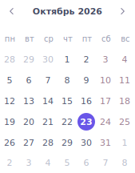
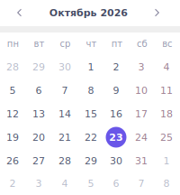

# Director Calendar — версия 0.11.0

Версия 0.11.0: автономная Windows x64-сборка и установщик для текущего пользователя. Python для запуска не нужен. База, история и настройки сохраняются в прежней папке данных; пароль остаётся в Windows Vault. Перед первым открытием существующей базы новой версией создаётся проверенная страховочная копия. [Установка, обновление и сборка](docs/WINDOWS-DISTRIBUTION.md).

Уточнение учёта: календарь и аналитика используют общее определение происхождения работы. Перенесённое событие исходного плана остаётся плановым; до фиксации дня происхождение обычных событий неизвестно. Число таких событий доступно в подсказке показателя «Вне плана». Локальное постфактум всегда внеплановое.

Версия 0.10.0: история без ограничения экрана последними 300 записями. Добавлены страницы по 50/100/200 записей, поиск по всему журналу, фильтры по датам изменений и событию, понятные описания «было → стало» и полное описание записи с переходом к существующему событию. Доступна история переименованных, удалённых и архивных событий. Чтение не переписывает исходный журнал; схема базы остаётся 4 (добавлены индексы для фильтрации). Версия 1.0 зарезервирована для релиза.

Версия 0.9.0: аналитика за день, календарную неделю и месяц. Добавлены взвешенное исполнение исходного плана, доля внеплановой работы по подтверждённому времени, отклонения начала и длительности, счётчик выполненных событий без времени. Доступны график динамики, разбивки по дням и категориям, список событий с переходом к заполнению факта и экспорт сводки с днями в CSV. Расчёты учитывают переносы, границы периодов и сохранённые правила контроля. Схема базы и зависимости не меняются.

Версия 0.8.0: завершены пять доработок надёжности и учёта. Во всех видах календаря действует общий отбор по слоям; список больше не показывает внеплановый факт в исходном плане и события без факта в слое «Факт». Во время синхронизации фиксация плана недоступна; при частичном/неудачном обновлении, отсутствии подтверждённой загрузки выбранного дня или давности более 30 минут перед фиксацией появляется предупреждение. Периоды и результаты загрузок сохраняются локально.

При фиксации сохраняются категория, участие в контроле и допустимое отклонение: последующие настройки не пересчитывают исходные показатели. Изменения правил записываются в историю. Для ранее зафиксированных событий схема 4 сохраняет правила по настройкам на момент обновления; прежние незаписанные переключения восстановить нельзя. Формы и меню защищены от сохранения устаревшей версии события. Повторный запуск активирует уже открытое окно; блокировка базы снимается после выхода и автоматически восстанавливается после аварии процесса.

В **Настройки → Данные и резервные копии** доступны ежедневное копирование, выбор папки, количество автоматических копий (по умолчанию 30), ручная копия и восстановление. Автоматическая копия создаётся при первом запуске за день; пока приложение открыто, проверка выполняется каждые 15 минут. Закрытое приложение не выполняет копирование. Удаляются только старые автоматические копии этой базы; ручные, миграционные и страховые копии сохраняются. Перед публикацией копии проверяются структура и целостность SQLite. При восстановлении сначала проверяется файл, сохраняется текущая база в отдельную страховую копию, затем в отдельном файле выполняются обновление формата и проверка. Только после успеха рабочая база заменяется. Приложение закрывается после восстановления; открой его снова ярлыком. Пароль Windows Vault не входит в копию базы.

Версия 0.7.0: возвращено создание событий внутри приложения. Кнопка «Добавить событие» над календарём и Ctrl+N открывают форму с режимами «Постфактум — вне плана» и «Запланировать локально». Постфактум сохраняется только фактический интервал и не включается в исходный план; локальный план фиксируется наравне с расписанием Mail.ru, без автоматической подстановки факта. Локальные записи видны в календаре, аналитике, истории и CSV и не отправляются в Mail.ru. Их можно редактировать и удалять с подтверждением; событие зафиксированного плана можно отменить, сохранив исходный план. Перед обновлением старого формата базы автоматически создаётся резервная копия.

Версия 0.6.0: добавлен запуск через ярлык на рабочем столе без окна консоли. Для уже установленного приложения дважды открой `create_desktop_shortcut.pyw` в папке проекта либо создай ярлык в разделе «Настройки → Запуск приложения». Ярлык использует окружение проекта, фирменную иконку и прежнюю локальную базу. При ошибке запуска показывается сообщение с путём к журналу.

Версия 0.5.2: жёлтый цвет статуса «Частично» стал более приглушённым в светлой и тёмной темах; календарь, список и контекстное меню используют общую палитру. На странице настроек увеличены промежутки между разделами, полями, флажками и пояснениями; внутренние отступы блоков выровнены. Кнопки подключения собраны в один ряд, поле допустимого отклонения стало компактнее, строки категорий — просторнее.

Версия 0.5.1: в недельном виде колонка выбранного дня в 1,5 раза шире остальных. Расширение следует за выбором даты в сетке, шапке, событии или мини-календаре; общая ширина календаря остаётся прежней. Заголовки, события на весь день, временная сетка и обработка кликов используют общие границы колонок, в том числе при горизонтальной прокрутке.

Версия 0.5.0: добавлены светлая и тёмная темы. Кнопка «Тёмная тема» / «Светлая тема» внизу левой панели переключает оформление сразу, без перезапуска. Выбор сохраняется на этом компьютере. Оформление охватывает календарь, мини-календарики, карточку события, меню статусов, списки, аналитику и настройки; привычные цвета статусов сохраняются.


Версия 0.4.6: колесо мыши больше не меняет значения полей даты, времени, чисел, списков и других полей ввода, даже если поле активно. Вместо изменения значения колесо прокручивает содержащую поле форму. Общий обработчик действует во всех окнах, включая настройки Mail.ru, карточку события и выбор года. Ввод с клавиатуры, кнопки полей, выбор даты и прокрутка открытых списков сохранены.

Исправление 0.4.5: повторный клик по полю даты закрывает календарик сразу. Состояние popup проверяется до перевода фокуса в поле, а захваченный всплывающим окном клик по полю обрабатывается до стандартного обработчика Qt. Потеря фокуса и повторная доставка того же клика больше не запускают повторное открытие. Добавлены проверки этих сценариев для поля, его текстовой части и кнопки.

Версия 0.4.4: клик по полю даты открывает мини-календарь, повторный клик закрывает его; кнопка внутри поля работает так же. В карточке события клик по дате открывает календарь, а часы и минуты редактируются отдельно. Выпадающее окно получило скругления, внутренние отступы, мягкую тень и зазор 8 пикселей от поля; у края экрана оно открывается сверху. Вне календаря курсор не остаётся указателем, после закрытия обычный курсор восстанавливается.

Версия 0.4.3: новый мини-календарь используется во всём приложении — в sidebar, выборе даты над расписанием и всех четырёх полях даты/времени карточки события. Общий компонент заменяет стандартную шапку Qt: единые стрелки, меню месяца/года, наведение и круглое выделение дня. Выбор даты факта сохраняет время, клавиатурное управление и допустимый диапазон дат работают через Qt; плановые поля Mail.ru остаются недоступны для редактирования.

Версия 0.4.2: показатели «В плане», «Выполнено», «Без подтверждения», «Вне плана», «Исполнение» и «Окна 07–19» перенесены под календарь. Уменьшены отступы, размер чисел и промежутки между карточками; для расписания остаётся больше высоты.

Версия 0.4.1: убраны подписи «Источник Mail.ru», «ПЛАН / ФАКТ» и слоган в боковой панели, подсказки и дублирующая кнопка «Открыть карточку» под календарём. Карточка по-прежнему открывается двойным щелчком; кнопка в правой панели выбранного события сохранена. Сообщения обновления Mail.ru появляются под заголовком только при синхронизации или ошибке; постоянная подсказка о подключении снизу удалена.

Версия 0.4.0: единственный источник расписания — Mail.ru. Создание, перенос, переименование и удаление событий выполняются в Mail.ru; приложение читает календарь и ведёт локальный учёт категорий, статусов, факта и комментариев. Кнопки и обработчики создания/удаления событий, а также выбор ручного источника удалены. Календарь, фиксация плана, показатели, свободные окна и CSV учитывают только Mail.ru. Старые ручные записи, журнал и ранее зафиксированные даты сохраняются в базе и резервных копиях.

Версия 0.3.6: обновлён мини-календарь слева. Собственная шапка со стрелками и единым выбором месяца/года заменяет стандартные элементы с синими рамками. Кнопки и даты реагируют на наведение; на интерактивных элементах показан курсор-указатель. Выбранный день выделен кругом, сегодняшний — отдельным контуром. Сохранены клавиатурная навигация, выбор месяца и года, связь с основным календарём и скрытие на небольшом окне.

Исправление 0.3.5: правая карточка события имеет фиксированную ширину 280 пикселей. Выбор событий с разной длиной названия, комментария и интервала больше не меняет ширину календаря. Перенос текста и скрытие правой панели на небольшом окне сохраняются.

Версия 0.3.4: для «Частично» установлен жёлтый фон с тёмной золотистой подписью, для «Перенесено» — синий цвет. Цвета едины для карточек календаря, контекстного меню и подписей статусов в списке.

Версия 0.3.3: пункты контекстного меню показывают те же цвета текста и фона, которые получит карточка события после выбора статуса. При наведении сохраняется соответствующий оттенок; текущий статус отмечен цветной галочкой. Используется общая функция цветов календаря, включая цвет категории для статусов без отдельной окраски.

Версия 0.3.2: правый щелчок по событию открывает меню выбора статуса — «Не подтверждено», «Выполнено», «Частично», «Отменено», «Перенесено». Текущий статус отмечен галочкой. Меню доступно в дневном, недельном, месячном виде, для событий на весь день и в списке. Изменение применяется к выбранному щелчком событию и записывается в историю; исходный план, актуальное и фактическое время сохраняются. Статусы импортированных событий учитываются локально и сохраняются при синхронизации Mail.ru.

Исправление 0.3.1: названия событий в недельной и дневной сетке переносятся по всей доступной высоте карточки. Отображаются только целые строки; если места не хватает, последняя строка заканчивается многоточием. В коротких событиях приоритет у названия, время и статус занимают только свободное место. Полное название и интервал доступны при наведении или в карточке события.

Исправление 0.2.2: при `calendar-data 404` программа пробует прочитать запись отдельным GET внутри выбранного календаря. Если запись остаётся недоступной, доступны частичная загрузка остальных записей и явное предупреждение. При частичной загрузке отсутствующие в ответе прежние события не помечаются исчезнувшими, а время последней полной синхронизации не меняется. Если недоступны все записи, обновление завершается ошибкой без изменения базы.

Исправление 0.2.1: ошибки отдельных служебных свойств CalDAV больше не блокируют доступное `calendar-data`; HTTP-статусы распознаются и без текстовой причины. Если само событие недоступно, сообщение содержит только номер ресурса и числовой статус, без содержимого ответа и секретов. Неполный ответ по-прежнему не применяется к базе.

Локальное Windows-приложение для бизнес-ассистента генерального директора: исходный план, актуальное расписание, факт выполнения и журнал изменений.

**Статус:** локальное приложение для событий из Mail.ru по CalDAV в режиме чтения и локальных записей, которые хранятся только в приложении. Первоначальный план фиксируется вручную кнопкой. Протокол, импорт и интерфейс проверяются автоматическими тестами; подключение к конкретной учётной записи подтверждается после ввода пароля на компьютере пользователя.

## Возможности версии 0.8

- Запуск ярлыком «Director Calendar» с рабочего стола без PowerShell и окна консоли.
- Календарь с видами «День», «Неделя», «Месяц» и «Список», мини-календарём и переходом к сегодняшней дате.
- Чтение одного календаря Mail.ru и локальный учёт его исполнения. Создание, переименование и перенос импортированных событий выполняются в Mail.ru.
- Создание локальных событий: постфактум вне плана или планирование внутри приложения; редактирование, удаление ошибочных записей и история изменений.
- Однократная фиксация первоначального плана на дату.
- Отдельное хранение текущего плана, фактического интервала и статуса.
- Отметки «выполнено», «частично», «отменено», «перенесено», «не подтверждено».
- Неподтверждённый факт **не подменяется** запланированным временем.
- Категории и настройка того, какие категории требуют контроля.
- Допустимое отклонение от плана (в минутах).
- Показатели за день, длительность по категориям и журнал изменений.
- Проверка свободных промежутков с **07:00 до 19:00** и пересечений в текущем расписании; предупреждение перед фиксацией плана.
- Экспорт отчёта в CSV (разделитель `;`, UTF-8 BOM — для Excel).
- Локальная SQLite-база; проверяемые ручные и ежедневные копии, настройка папки/хранения и восстановление со страховой копией.

Подробное решение по стеку и рассмотренные альтернативы — в [`docs/ADR-0001-stack.md`](docs/ADR-0001-stack.md).

## Технический стек (октябрь 2026)

- Python **3.13** (исполняемая среда; возможно развитие до 3.14 после тестирования).
- PySide6 **6.12.0** (Qt Widgets — настольный интерфейс Windows).
- SQLite (`sqlite3` в стандартной библиотеке Python).
- Pytest — автоматические тесты; GitHub Actions — тесты на Windows и Linux.
- CalDAV: только HTTPS REPORT через `requests`; iCalendar и повторы — `icalendar` и `recurring-ical-events`; XML — `defusedxml`; пароль Windows — `keyring` с явным WinVault backend.

Модули: `history.py` — описания записей истории; `history_ui.py` — поиск, фильтры и страницы журнала; `analytics.py` — расчёты и CSV за период; `analytics_ui.py` — экран аналитики; `schedule.py` — общий отбор слоёв; `backups.py` и `backup_ui.py` — копии и восстановление; `instance.py` — единственный экземпляр; `storage.py` — правила учёта и БД; `calendar_view.py` — календарная сетка и размещение событий; `theme.py` — оформление; `inspector.py` — карточка и график; `ui.py` — навигация и формы; `mail_calendar.py` и `mail_ui.py` — чтение Mail.ru; `main.py` — запуск. Логика учёта отделена от интерфейса и проверяется автоматическими тестами.

## Запуск на Windows 10/11

### Если приложение уже установлено

1. Закрой приложение, обнови исходники проекта и дважды щёлкни по `create_desktop_shortcut.pyw` в его папке.
2. Подтверди сообщение «На рабочем столе создан ярлык».
3. Дальше открывай **Director Calendar** с рабочего стола двойным щелчком. PowerShell и окно командной строки для запуска больше не нужны.

Другой способ создания ярлыка: в открытом приложении перейди в **Настройки → Запуск приложения → Создать ярлык на рабочем столе**. Если Windows не связывает `.pyw` с Python, используй эту кнопку. Повторное создание обновляет существующий ярлык и не добавляет дубликаты. Учитывается системная папка рабочего стола, включая перенаправление в OneDrive.

Ярлык ссылается на текущую папку проекта; после её переноса создай его заново. Данные и подключение Mail.ru остаются прежними. Запуск через ярлык не устанавливает зависимости и не обращается к GitHub.

Если приложение не смогло открыться, появится сообщение с путём к файлу `startup-error.log` в папке данных. Для диагностики также можно запустить `main.py` через консоль.

### Первоначальная установка

Потребуется установленный **Python 3.13 (64-bit)** с доступной командой `py` и подключение к интернету *для первоначальной установки библиотек*.

1. Распакуй архив и открой PowerShell в папке проекта.
2. Выполни:

```powershell
py -3.13 -m venv .venv
.\.venv\Scripts\python.exe -m pip install -e .
.\.venv\Scripts\python.exe main.py
```

Либо запусти `scripts\run_windows.ps1` из PowerShell (может потребоваться разрешить выполнение собственных скриптов). После первоначальной установки создай ярлык способом выше. У приложения отдельное окно Windows, **не браузер**.

При первом запуске программа создаёт папку и базу данных (пути по умолчанию):

`%LOCALAPPDATA%\DirectorControl\director_control.db`

В Linux/macOS для тестирования используется `~/.local/share/director-control/`. Путь можно переопределить переменной окружения `DIRECTOR_CONTROL_DATA_DIR`.

**База данных, журнал событий и резервные копии не должны попадать в GitHub.** Они исключены через `.gitignore` и хранятся вне папки проекта. Рекомендуется приватный репозиторий.

## Интерфейс


На иллюстрации используются только тестовые записи; в приложение они не добавляются.

Общий мини-календарь для sidebar и полей даты:



Тот же компонент во всплывающем выборе даты:



- Боковая навигация: календарь, аналитика, история и настройки.
- Режимы **День / Неделя / Месяц / Список**. Последний выбранный режим сохраняется.
- Временная сетка на 24 часа: пересекающиеся встречи располагаются рядом, события на весь день — отдельно. Текущий момент отмечен линией.
- Выбор слоя **Расписание / Исходный план / Факт**. «Расписание» показывает актуальный план и внеплановые локальные факты; слой исходного плана исключает записи постфактум. Пустой факт не подменяется планом.
- Один щелчок выбирает событие. На широком высоком окне справа показаны его название, источник, исходный план, актуальное время, факт и комментарий, а также кнопка **Открыть карточку**. Двойной щелчок открывает карточку на любом размере окна.
- **Добавить событие** (Ctrl+N) открывает форму локальной записи. По умолчанию выбран режим **Постфактум — вне плана** со статусом «Выполнено»: проверь название, категорию, фактические начало/конец и при необходимости добавь комментарий. Данные сохраняются только после нажатия «Создать».
- В режиме **Запланировать локально** указывается плановый интервал; факт заполняется отдельно. Локальные планы участвуют в фиксации исходного плана, записи постфактум — всегда вне него, даже до первой фиксации дня.
- Локальная карточка позволяет менять название, время, статус, категорию и комментарий. Удаление требует подтверждения и сохраняется в истории. Включённую в исходный план запись нельзя удалить; для неё используется статус «Отменено».
- Карточка события Mail.ru позволяет менять только категорию, факт, статус и комментарий. Название, плановое время и удаление по-прежнему управляются в Mail.ru.
- Поиск фильтрует события **только открытого периода** по названию, категории и комментарию. Источник «Локально» показан в карточке и списке; синхронизация Mail.ru не меняет локальные записи.
- Ссылка «+N событий» в месяце открывает список выбранного дня. Мини-календарь, стрелки и кнопка **Сегодня** помогают перемещаться по датам.
- Компактные показатели под календарём относятся к выбранному дню. На странице «Аналитика» можно независимо выбрать день, неделю или месяц, сравнить план и подтверждённый факт, найти пропуски времени и отклонения.
- На небольшом окне второстепенная панель скрывается и временная сетка становится плотнее. Окно при первом открытии подбирается под доступную область экрана.

Данные, параметры подключения, пароль в хранилище Windows и существующий исходный план сохраняются. При первом запуске 0.8 база старого формата обновляется до схемы 4: исходная копия сохраняется в папке `backups` рядом с базой, затем схема меняется одной транзакцией с проверкой связей. Существующие события, исходный план, история и настройки сохраняются. Старые архивные ручные записи раннего прототипа остаются в архиве; новые локальные события учитываются отдельно. Дополнительные зависимости не нужны.

## Работа с расписанием

Создай расписание в Mail.ru. В приложении выбери дату и нажми **Обновить Mail.ru**. После согласования дня нажми **Зафиксировать план**. Двойной щелчок по строке открывает карточку для заполнения факта, статуса и комментария. Аналитика и история доступны на отдельных вкладках. Старые ручные записи остаются в истории и резервных копиях, но не участвуют в календаре, фиксации новых планов, показателях и CSV.

Создание демонстрационного расписания удалено. При обновлении старые автоматически созданные примеры удаляются только при совпадении полного исторического следа генерации в журнале: создание 11 записей, фиксация плана и шесть изменений с исходными отметками. Перед очисткой автоматически сохраняется резервная копия. Похожие названия и отдельные записи без такого следа не удаляются. Данные Mail.ru исключены из очистки. Если после удаления примеров у даты не осталось реального исходного плана, снимается и фиксация демонстрационного дня.

## Подключение Mail.ru

1. Перед обновлением существующей версии создай резервную копию на вкладке **Настройки**. Загрузи новые исходники и снова выполни `python.exe -m pip install -e .` из своего виртуального окружения.
2. Открой **Настройки → Календарь Mail.ru**.
3. Вставь полную ссылку **CalDAV** из настроек своего календаря и полный адрес почты для входа.
4. Введи **пароль внешнего приложения**, созданный в Mail.ru. Основной пароль почты не нужен. Пароль вводится только локально, не отправляется в чат или GitHub.
5. Оставь часовой пояс **Europe/Moscow** для расписания в московском времени. События с UTC/TZID переводятся в этот пояс; события без часового пояса трактуются в нём. После первого импорта или создания локального события менять пояс в этой версии нельзя — это переинтерпретировало бы сохранённый план и факт.
6. При желании включи сохранение пароля в **Диспетчере учётных данных Windows**. Без сохранения пароль живёт только до закрытия приложения. В Linux/macOS эта версия использует только память текущего запуска.
7. Нажми **Сохранить подключение и обновить**. Результат или причина ошибки появится под кнопками и в верхней строке окна.

Кнопка **Обновить Mail.ru** на вкладке «План / Факт» получает события за 30 дней до и 90 дней после выбранной даты, включая эту дату. Для другой даты выбери её и обнови снова. Можно включить обновление при запуске; периодического фонового опроса пока нет.

### Как сохраняется план и факт

- У каждого события стабильный ключ из календаря, учётной записи, UID и исходного RECURRENCE-ID. Повторная загрузка не создаёт дублей; перенос отдельного повтора сохраняет его идентичность.
- Mail.ru управляет названием и текущим временем. Меняй их в исходном календаре; поля в импортированной карточке заблокированы.
- Здесь заполняются категория, локальный статус, фактическое время и комментарий. Они переживают обновления. Явная отмена в Mail.ru меняет статус, если локальный статус/факт ещё не задан. Если факт уже заполнен, рядом с локальным статусом показывается отметка отмены источником.
- Первоначальный план фиксируется отдельно кнопкой **Зафиксировать план** и больше не перезаписывается синхронизацией.
- События без времени показываются как «весь день» и по умолчанию не входят в контроль выполнения. Они не занимают все часы рабочего дня и не добавляют 24 часа в первоначальный почасовой план.
- Отсутствие события в ограниченном ответе сервера не доказывает удаление. Запись, её план и факт остаются с отметкой **проверить Mail.ru**. Это бывает и при переносе за пределы загружаемого периода. Явное удаление из локальной базы импортированных записей запрещено.
- Ошибка сети, авторизации, XML или разбора события останавливает обновление до записи в базу. Отдельный случай `calendar-data 404` допускает частичную загрузку доступных записей с явным предупреждением; старое расписание сохраняется и проверка исчезновений отключается на этот запуск.

### Первая проверка на своём календаре

1. Создай в Mail.ru вымышленную встречу **Тест Director Calendar**, выбери её дату и обнови приложение.
2. Обнови второй раз: запись должна остаться одна.
3. Зафиксируй план на тестовую дату, перенеси встречу в Mail.ru и обнови: исходный план останется, актуальное время изменится.
4. Заполни локальный факт и комментарий, снова измени встречу в Mail.ru: факт и комментарий должны сохраниться.
5. Проверь ежедневный повтор и перенос одного его экземпляра. При отмене/удалении проверь соответствующую отметку источника.

Проверки с вымышленными iCalendar-ответами не заменяют эту проверку сервера Mail.ru. При ошибке пришли только текст статуса без пароля.

## GitHub и контроль версий

Приватный репозиторий проекта: https://github.com/payuktv/director-calendar.
Приложение называется Director Calendar. Python-пакет и прежний путь к базе DirectorControl сохраняются для совместимости.

Для получения исходников в PowerShell:

```powershell
git clone https://github.com/payuktv/director-calendar.git
cd director-calendar
```

Без Git: открой репозиторий, выбери **Code → Download ZIP**, распакуй архив и открой PowerShell в папке с `main.py` и `pyproject.toml`.
Далее выполни команды из раздела «Запуск на Windows 10/11».

Основная ветка `main` должна оставаться работоспособной. Новые функции — через `feature/...` и Pull Request; небольшие изменения — отдельными коммитами.
Рабочая база данных, отчёты и резервные копии остаются локально и исключены через `.gitignore`.

## Тесты

```powershell
.\.venv\Scripts\python.exe -m pip install -e ".[dev]"
.\.venv\Scripts\python.exe -m pytest -q
```

В GitHub Actions файл `.github/workflows/ci.yml` запускает тесты при `push` и `pull_request`. Qt smoke-тест использует виртуальную (`offscreen`) графическую платформу.

Набор тестов разделён по возможностям платформы. Общие проверки выполняются и в Windows, и в Linux. `tests/windows/test_shortcut.py` проверяет настоящий ярлык `.lnk`, Windows Shell, `pythonw.exe`, запуск приложения без консоли и путь с кириллицей. Эта проверка входит в Windows-набор и выполняется полностью; в Linux каталог `tests/windows` не собирается, поскольку Windows Shell там отсутствует. Это не замена реальной проверки имитацией или успешной заглушкой. Проверка отказа от создания Windows-ярлыка на неподдерживаемой платформе остаётся в общем наборе.

CI сохраняет JUnit-отчёт и проверяет его отдельной командой. Любой пропуск, ошибка, отсутствующий или пустой отчёт делают проверку неуспешной. В Windows дополнительно требуется наличие и успешное завершение именно теста настоящего ярлыка: исключение этого теста из запуска не может дать зелёный результат CI. Отсутствие обязательной PySide6 теперь считается ошибкой установки зависимостей, а не поводом пропустить GUI-тест. Итоги публикуются в сводке задания GitHub Actions.

Чтобы воспроизвести полную проверку в Windows:

```powershell
.\.venv\Scripts\python.exe -m pytest -q --junitxml=pytest-results.xml
.\.venv\Scripts\python.exe scripts\verify_test_results.py pytest-results.xml --platform Windows
```

В Linux используется тот же отчёт с `--platform Linux`; итог содержит только проверки, применимые к Linux, без пропущенных тестов Windows. Сам отчёт не изменяется проверяющим скриптом. Версия приложения остаётся 0.10.0: изменена инфраструктура тестирования, пользовательские функции и формат данных не меняются.

## Сборка Windows exe

Используется зафиксированная конфигурация PyInstaller и Inno Setup 6. На Windows x64 с Python 3.13 запусти `scripts/build_windows.ps1`. Получатся установщик и переносимая папка в ZIP. Ошибка любого этапа прерывает сборку.

Workflow **Windows distribution** собирает текущую версию и предыдущую 0.10.0, проверяет установку, запуск, обновление, запрет установки при открытом приложении, повторную установку и сохранность данных после удаления. Только после успешной приёмки публикуется артефакт **DirectorCalendar-Windows-x64**. Подробности: [Windows-дистрибутив](docs/WINDOWS-DISTRIBUTION.md).

## Ограничения прототипа и следующие этапы

- **CalDAV работает только на чтение одного календаря Mail.ru**. Обратной записи, автоклассификации категорий и выбора нескольких календарей нет. Замена подключённого календаря после первого импорта пока заблокирована во избежание смешения расписаний.
- **Нет синхронизации между ПК**. SQLite предназначена для одного локального пользователя.
- **Нет автоматического мониторинга без запущенного приложения**. Внешний фоновый сервис пока не реализован.
- **Нет конструируемых отчётов и пользовательских полей**. Добавим по согласованным требованиям.
- Повторы обрабатываются в ограниченном периоде. Секундные/минутные серии и события с нулевой либо неопределённой длительностью не поддерживаются: импорт останавливается с ошибкой, без изменения данных. После изменения целой серии часть старых экземпляров может потребовать ручной проверки.
- При переносе мероприятия на другую дату оно видно как в дне первоначального плана, так и в дне актуального расписания. В периодной аналитике перенос зафиксированного события сохраняет связь с исходным планом: он не становится внеплановым только из-за смены даты.
- План и факт хранятся в отображаемом часовом поясе без смещения в строках SQLite. TZID/UTC источника переводятся при импорте; смена часового пояса после первого импорта пока запрещена. Для автоматических процессов без запущенного приложения нужен отдельный сервис.

## Аналитика за период

Открой **Аналитика** и выбери **День**, **Неделя** или **Месяц**. Неделя — понедельник–воскресенье, месяц — с первого до последнего календарного дня. Стрелки переключают целый период; дата и «Сегодня» выбирают опорный день. Выбранные режим и участие неконтролируемых категорий сохраняются. Дата сначала следует за календарём; внутри аналитики можно выбрать другую дату. Поиск, вид и слой основного календаря не фильтруют отчёт. Кнопка обновления Mail.ru на странице аналитики использует её опорную дату.

- **Исполнение исходного плана**: число событий со статусом «Выполнено» / число событий зафиксированного плана, начавшихся в периоде. Частичные, отменённые, перенесённые и неподтверждённые остаются в знаменателе. Итог недели и месяца считается по всем событиям, а не усреднением дневных процентов. При отсутствии плана показано «—».
- **Подтверждённое время**: сумма заполненных фактических интервалов событий «Выполнено» и «Частично». Плановое время не подставляется. Пересекающие полночь и границы отчёта интервалы делятся по дням с точностью до секунд. Задача исходного плана считается один раз по дате его начала. События на весь день могут участвовать в счётчике задач, но не создают 24 часа планового времени.
- **Доля внеплановой работы**: подтверждённое время вне плана / всё подтверждённое время. Внеплановыми считаются локальные записи постфактум и события без исходного плана, день текущего начала которых уже зафиксирован. Любое событие с исходным планом остаётся плановым, в том числе перенесённое из другого периода. Если день не был зафиксирован, происхождение работы отмечается как неизвестное. Такое время входит в общий факт; доля внепланового показана с **≥** как нижняя оценка, а объём неизвестного времени указан отдельно. Без факта доля — «—».
- **Отклонения начала и длительности**: фактическое начало минус исходное начало; фактическая длительность минус исходная длительность. В таблице плюс означает позже/дольше, минус — раньше/короче. В сводке — средние **абсолютные** отклонения: положительные и отрицательные не погашают друг друга. Выборка — выполненные и частичные события с полным планом и фактом, начало факта которых попадает в период, кроме исходных событий на весь день. По переносу из другого дня учитывается полный сдвиг. Сравнение использует полные интервалы, даже когда минуты графика обрезаны границей отчёта. Отклонение строго больше сохранённого допуска считается нарушением; равенство допустимо. Метка отклонения в основном списке использует то же правило начала и длительности.
- **Выполнено без времени**: выполненные события без полного фактического интервала, кроме текущих событий на весь день. Они относятся к исходной дате, а при отсутствии исходного плана — к текущей. Нажми показатель, чтобы открыть список; двойной щелчок или Enter открывает карточку для заполнения. Изменение сразу обновляет отчёт. Частичные без времени не входят в этот счётчик и не создают часы.

По умолчанию отчёт включает только контролируемые категории. Для зафиксированных событий участие в контроле, категория плана и допуск берутся из сохранённого снимка правил; факт группируется по текущей категории. Переключатель позволяет включить все категории явно.

Вкладки **Динамика**, **По дням**, **Категории** и **События** дают переход от общей картины к записям. Нажатие на день графика или активация строки дня открывает события этого дня. Фильтры событий показывают пропуски факта, внеплановую работу, отклонения вне допуска и записи без зафиксированного плана. Эти фильтры и выбор дня внутри списка не меняют сводные показатели.

В отчёте указаны дни с фиксацией плана и, при подключённом Mail.ru, дни с полной загрузкой. Покрытие загрузки проверяется по последней попытке, покрывающей каждый день, для этого же календаря. Историческая загрузка не обязана быть моложе 30 минут; это показатель покрытия, а не гарантия актуальности источника. Частичные и неудачные попытки не считаются полными. Отдельно отмечены исчезнувшие/отменённые в источнике записи и пересечения факта. Время суммируется по событиям: повторно учтённые из-за пересечений минуты показаны явно, а не вычтены незаметно.

**CSV** экспортирует весь выбранный период и область категорий: строку «Итого» и каждый календарный день. Формат — UTF-8 с BOM, разделитель `;`, десятичная запятая. Неопределённые проценты и средние оставлены пустыми. Итоговые показатели качества и исходные числа позволяют проверить расчёт. Данные читаются одной транзакцией SQLite; формирование отчёта не фиксирует план, не заполняет факт и не меняет события.

## Поиск и просмотр истории

На странице **История** доступны все сохранённые записи. В таблицу загружается только выбранная страница: **по 50, 100 или 200 записей**. Кнопки **Старее**, **Новее** и **К началу** позволяют пройти весь журнал, включая записи старше прежних 300. Размер страницы сохраняется на этом компьютере. Приложение не удаляет историю при перелистывании и поиске.

**Поиск** проверяет весь журнал, а не только открытую страницу: название события или объекта, действие, понятное описание изменений и время записи. Регистр не важен; «е» и «ё» считаются одинаковыми. Несколько слов должны встретиться в одной записи, но могут находиться в разных частях описания. Например, `совещание выполнено` найдёт изменение статуса соответствующей встречи. Знаки `%`, `_`, кавычки и другие символы ищутся как обычный текст. Поиск применяется после короткой паузы при вводе или по Enter.

В поле **Событие** можно выбрать конкретную запись календаря или ввести часть названия. При выборе используется идентификатор события, поэтому одинаковые названия не смешиваются. Частичное название проверяется также по прежним названиям события и показывает всю его историю. Удалённые и архивные события помечены в списке; их записи остаются доступны. Для настроек и обслуживания есть отдельный вариант фильтра. Кнопка **По выбранной записи** устанавливает фильтр события из выделенной строки, сохраняя остальные условия.

Включи **Дата изменения**, чтобы задать диапазон **С / По**. Обе даты включены. Это даты записей журнала, а не плановые даты встреч. По умолчанию ограничение по датам выключено. Поиск, даты и событие работают совместно; **Сбросить фильтры** возвращает весь журнал.

Действия и поля показаны обычным языком: `actual_start` отображается как «Фактическое начало», статусы — по-русски, даты — в формате `дд.мм.гггг`, изменения — **было → стало**. Состояние источника не трактуется как подтверждённое удаление: запись «Нет в ответе Mail.ru» просит проверить источник. Изменения категорий, допуска времени, резервного копирования и восстановления тоже имеют понятные описания. Исходные данные журнала сохранены в прежнем виде, включая записи старых версий.

**Двойной щелчок или Enter** открывает полное описание без ограничения высотой строки. Длинные комментарии отображаются обычным текстом. Кнопка **Открыть событие** доступна, пока локальное событие или запись Mail.ru существует в действующем календаре; удалённые и архивные записи можно читать без открытия карточки.

При просмотре старых страниц новые записи не сдвигают строки: выбранная страница, выделение и прокрутка сохраняются. После обновления данных появляется число новых записей по текущим фильтрам. **Обновить** или **К началу** открывает свежие записи и сохраняет фильтры. При возвращении на первую страницу истории через навигацию показываются последние изменения. Чтение выполняется согласованным снимком SQLite; страницы идут по идентификаторам записей, поэтому одинаковое время изменения не создаёт пропусков и повторов. Данные Mail.ru продолжают использоваться только для чтения.

## Конфиденциальность

Не используй реальные ФИО, подробности личных встреч, пароли или документы директора при демонстрации проекта или публикации скриншотов. Резервные копии SQLite содержат полный журнал мероприятий. Программа пока не шифрует файл БД: соблюдай корпоративные правила доступа к ПК и диску (например, BitLocker), а резервные копии храни в защищённом месте.

