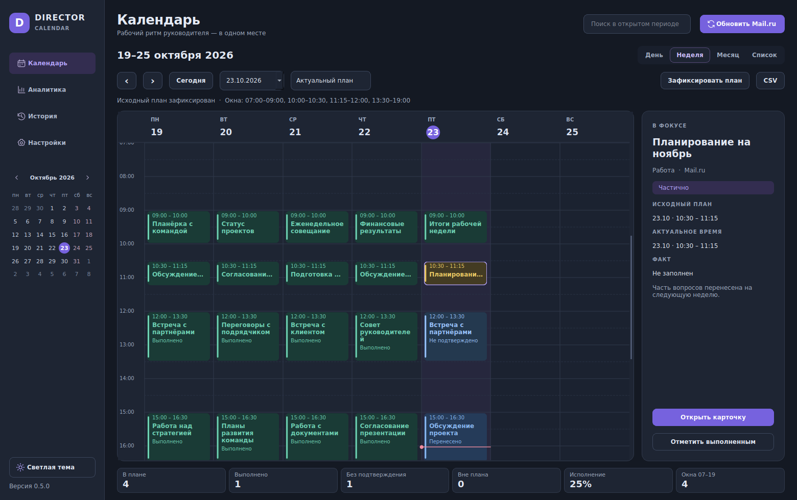

# Director Calendar — v1.7.1

A local Windows desktop application for tracking a CEO's schedule, original plan, actual work and change history. Mail.ru is a read-only calendar source; local events and execution records stay on the user's computer.

**Status:** stable v1.7.1. The original v1.0 feature scope passed target-system acceptance on v0.13.10; see the [acceptance record](docs/ACCEPTANCE-v1.0.0.md) and mandatory [publication gates](docs/RELEASING.md). The interface supports English and Russian.

## Features

- Day, week, month and agenda views, with separate current schedule, original plan and actual-work layers.
- Read-only Mail.ru CalDAV import, including recurring events and individual exceptions.
- Local planned events and post-factum records for unplanned work; no writes to Mail.ru.
- Manual, one-time daily plan fixation, execution statuses, actual times and comments.
- Daily, weekly and monthly analytics, data-quality indicators and CSV export.
- Full retained change history with search, date/event filters and pagination.
- Automatic language selection from the system display language. Choose English, Русский or Automatic in **Settings → Application → Application language**. The interface switches as soon as you select the language.
- Light/dark themes, desktop shortcuts and single-instance protection.
- Verified manual/daily backups, update backups and startup recovery for damaged databases.
- Standalone Windows x64 installer and portable ZIP. Python is bundled.
- Windows update notifications with release notes, background download on approval and a separate restart confirmation.




Screenshots use synthetic data and may show an earlier interface revision. No demo schedule is created on a fresh installation.

## Install on Windows

Target platform: Windows 10/11 x64. Use the installer for normal use; Python, PowerShell and administrator privileges are not required to run the installed application.

1. Open [GitHub Releases](https://github.com/payuktv/director-calendar/releases) and select the intended version, currently **[v1.7.1](https://github.com/payuktv/director-calendar/releases/tag/v1.7.1)**.
2. Read its release notes and known limitations. Versions below v1.0.0 are marked **Pre-release**.
3. Download the installer from **Assets**. GitHub's automatic source-code archives are for development, not installation.
4. Close any running Director Calendar instance, including older source-based launches.
5. Run `DirectorCalendar-1.7.1-Setup-x64.exe` as your normal Windows user.
6. Open **Director Calendar** from the desktop or Start menu.

Release assets include the installer, portable ZIP, SHA-256 checksums, build/dependency information, distribution acceptance report, upgrade-source record and release manifest. A release is published only after Windows/Linux tests and Windows distribution acceptance pass for the same source commit, and uploaded assets are verified. Releases provide the permanent download channel; verified files are uploaded directly without intermediate Actions artifact storage. Installers are not currently Authenticode-signed.

For portable use, extract the **entire** `DirectorCalendar-1.7.1-portable-x64.zip`. Keep `DirectorCalendar.exe` alongside `version.txt` and `_internal` together. Data still lives in AppData, not beside the executable. Create a shortcut from Settings if needed.

## Update and data locations

The calendar checks for stable versions at startup and daily while open. Read the changes in the update window and choose **Download update** or **Later**. Downloading closes this window. The bottom-left update icon reopens the notes or shows progress. After verification, a small notification offers **Restart** or **Later**. An ordinary close and relaunch keeps the current version until you confirm installation. The prepared package and its notes remain available offline. You can switch off automatic checks or check manually in **Settings → Application → Application updates**.

To move from v1.2.0 or earlier, install v1.7.1 once or extract its complete portable ZIP. Versions v1.1.0 and v1.2.0 can find this transitional installer through their existing update panel. Subsequent versions use the portable ZIP directly with the existing shortcut. The version shown in the calendar reflects the running package. Windows Installed Apps identifies the original installer. Versions v1.3.0–v1.3.2 use their existing updater for the transition to v1.7.1.

The updater requests public release metadata over HTTPS, checks the ZIP's exact size and SHA-256, and tests the extracted runtime before making it available. Only the official repository and GitHub release asset hosts are used. A slow transfer can continue as long as bytes are arriving. After a temporary disconnection, the app retries up to three times and requests the remaining bytes. If the server returns the whole package, it restarts the transfer and verifies it. Closing the calendar cancels an unfinished transfer. Each verified version lives under `.director-updates` beside the application, so portable installations need a writable folder. The database, credentials and pre-update backup use their existing locations.

| Item | Default location |
| --- | --- |
| Installed program | `%LOCALAPPDATA%\Programs\DirectorCalendar` |
| Database, settings and history | `%LOCALAPPDATA%\DirectorControl\director_control.db` |
| Default backups | `%LOCALAPPDATA%\DirectorControl\backups` |
| Preserved emergency-recovery files | `%LOCALAPPDATA%\DirectorControl\recovery` |
| Saved Mail.ru password | Windows Credential Manager, service `DirectorControl.CalDAV` |

Installation, update and uninstallation preserve the separate data directory and saved credentials. Before an existing database is opened by a different application version, a verified `before-update-*.db` backup is required. Failure to create it prevents normal startup. Reopening the same version does not create duplicate version backups.

If you previously set `DIRECTOR_CONTROL_DATA_DIR`, preserve that environment variable when launching the new installation. A custom database location is not discovered automatically. Moving to another Windows account or PC requires entering the Mail.ru application password again; database backups do not contain Windows Vault credentials.

The installer blocks downgrades and installation/removal while a v0.11.0-or-later instance is running. Close earlier versions manually before updating. For a portable update, extract the new package into a separate directory and update the shortcut; do not mix `_internal` directories from different versions.

## Connect Mail.ru

1. Open **Settings → Mail.ru**.
2. Enter the full CalDAV collection URL from your calendar settings and your full email login.
3. Enter a Mail.ru **application password**, locally on your computer. Do not put it in chat, source files or GitHub.
4. Select the display time zone, normally `Europe/Moscow`.
5. Optionally save the password in Windows Credential Manager. Otherwise it is kept only for the current session.
6. Save the connection and update the calendar.

The application imports 30 days before and 90 days after the selected date. On the Analytics page, synchronization uses that page's anchor date. Automatic loading at startup is optional; periodic polling is not implemented.

Change imported titles, scheduled times and recurrence rules in Mail.ru. Categories, local execution status, actual time and comments are maintained here and survive synchronization. Repeated imports preserve event identity. The original plan is never overwritten by synchronization.

A missing event in a bounded server response is **not proof of deletion**. After a complete sync, an event starting today or later without a frozen plan, actual time, manual status or comment is withdrawn from the current schedule. Today uses the selected display time zone; an unfrozen event earlier today is eligible too. Its identity and history remain; reappearance restores the same record. Events starting on an earlier calendar date and locally protected records retain a source warning. Previously flagged eligible events are reconciled on the next complete sync. Network, authorization and parse failures preserve the previous data. A recoverable `calendar-data 404` can produce an explicitly marked partial import; disappearance detection is disabled for that import.

Mail.ru may include the selected calendar collection itself in a query response. The client requests resource types and ignores that collection's `calendar-data 404` only when a successful response explicitly identifies the exact selected address as both a collection and a calendar. Unreadable event resources still make the import partial. Withdrawn records can be opened from History in a read-only card without inventing a current time.

Cancelling or explicitly marking an event as failed locally and then removing it in Mail.ru is an expected workflow. After a complete query confirms its absence in the loaded period, the retained record has no source warning. Its local status and failure attribution remain in the calendar, original plan, analytics and History; no actual work time is invented. Unfrozen records also retain this outcome. Source reappearance or cancellation never silently overwrites the chosen local status. Reverting to an unresolved status while the source remains missing restores the warning. Missing pending, completed, partial or moved events and source cancellations conflicting with a local completion still require review. The synchronization result, agenda, inspector and analytics use the same source-state rules.

When the sync result reports outstanding warnings, click **Needs review** in the calendar or in **Settings → Mail.ru**. The list shows the date, event name, local status and reason for each warning in the connected calendar. Select an entry to open its event card. The list includes unresolved warnings across dates and is available from saved local data after restart.

After importing a calendar, switching accounts/collections is blocked. The display time zone cannot be changed once schedule events exist. UTC/TZID values are converted on import; floating times use the selected zone.

Synchronization runs in a disposable process: 512 MiB OS memory limit, a 20-second CPU budget and a 60-second overall deadline cover network reads, parsing, recurrence expansion and result serialization. Input is limited to 16 MiB and accepted snapshots to 20,000 instances. Results are consumed incrementally, but the process boundary also contains the recurrence library's internal buffering. Limits fail closed: an error, timeout or cancellation never applies a partial snapshot or interprets it as an empty calendar. Credentials travel only through private pipes. The child never opens the application database or diagnostic log.

Use **Cancel update** to stop synchronization. Closing the window cancels the worker and closes after cleanup; queued results from that cancelled attempt are discarded. The installed worker uses the same executable as the application, preserving VPN executable exclusions. When running from source, the Python executable requires the same network access.

Before relying on a connection, use a synthetic appointment to verify initial import, duplicate-free reimport, rescheduling after plan fixation, preservation of actual time/comments, and a recurring event with one moved occurrence.

## Daily workflow

1. Select the date and refresh Mail.ru.
2. Review the schedule, conflicts and free intervals within the 07:00–19:00 workday.
3. Fix the original plan once the day is agreed. Fixation is disabled during synchronization; missing, partial, failed or older-than-30-minute coverage produces a warning.
4. Select an execution status. **Done** fills an entirely missing actual interval from the current scheduled time when saved; an existing or explicitly entered actual interval takes priority. Actual time can then be edited. **Partial** does not fill time automatically and waits for an actual interval in analytics. All-day events are exempt from automatic time and missing-time prompts. Existing historical records are not backfilled by opening the application or report.
5. Use **Add event** or **Ctrl+N** for local planning or post-factum unplanned work.
6. Review analytics and incomplete actual-time records; use History to inspect changes.

A local event already included in the original plan cannot be deleted; cancel it while retaining its baseline. Imported events cannot be deleted locally. Post-factum local work is always unplanned. A baseline event moved to another day remains planned; ordinary events on an unfixed day have unknown work origin.

Plan fixation preserves the category, tracking flag and time tolerance used for baseline calculations. Later settings changes do not rewrite those saved rules. All-day events are displayed separately and do not contribute 24 hours of planned work.

Use **Failed · assistant** or **Failed · director** when an event did not happen because that participant missed it or forgot. Attribution is selected by the user, never inferred from Mail.ru. Use **Cancelled** for an agreed cancellation. Comments can record the reason. Failed events retain their plan and history but do not contribute completed tasks or actual working hours, even if an earlier actual interval remains saved.

## Analytics and exports

Reports cover a day, Monday–Sunday week or calendar month. Calendar search and display-layer filters do not filter the report. By default, reports include tracked categories; all categories can be included explicitly.

| Metric | Meaning |
| --- | --- |
| Plan completion | Completed baseline events / all baseline events starting in the period; period totals are not averages of daily percentages |
| Confirmed actual time | Actual intervals of completed or partially completed events, clipped to report/day boundaries |
| Unplanned share | Confirmed unplanned time / all confirmed actual time; unknown-origin time makes this a lower bound, shown with `≥` |
| Start/duration deviation | Actual minus original plan; summary cards use absolute deviations so early and late values do not cancel out |
| Awaiting actual time | Partial and historical completed events missing a full actual interval, excluding current all-day events |
| Cancelled / Failed | Separate outcome totals, including unfrozen days; failures are split by assistant/director and can be opened as filtered event lists |

No plan or actual data produces an undefined metric rather than a misleading zero. Deviation comparisons use complete original/actual intervals and the saved tolerance; equality with the tolerance is allowed. Overlapping actual intervals are summed, with duplicated minutes reported explicitly.

Reports show plan-fixation coverage, complete Mail.ru loading coverage, source warnings and missing actual time. Loading coverage is not a guarantee that the remote calendar is still current. Drill down by day, category or event; open an event to correct its actual time.

Period CSV exports include a total row and every day in the selected period. Files use UTF-8 with BOM, semicolons and decimal commas. Undefined values are blank. Reports are read from a consistent SQLite snapshot and do not modify the plan or fact records.

Cancellations and failures are counted once on the original plan's start date, otherwise the current start date (or actual start for actual-only records). They respect the selected category scope and frozen tracking rules. Separate baseline counts preserve the completion denominator; CSV exports include both baseline and overall outcome counts. Overnight events are not counted again on the following day.

## History

All retained audit records are accessible, including entries beyond the former 300-record view. Pages contain 50, 100 or 200 entries.

- Search covers the entire journal, including readable descriptions and former event titles, not only the visible page.
- Open **Filters** to narrow a search by event or change date. Both dates are inclusive and refer to audit timestamps. The filter count and reset action stay visible when the panel is closed.
- Selecting an event uses its ID, so identical titles do not mix unrelated histories. Deleted and archived event history remains readable.
- Each row shows a one-line preview. Select **Open entry**, double-click the row or press Enter for the full description. Existing events can be opened from their history entries.
- Older pages keep their position when new entries arrive. Refresh or return to the first page to see new records.

Browsing and searching do not delete or rewrite the original audit journal.

## Backups and recovery

### Routine backups and restoration

Use **Settings → Backups** to choose a backup directory, create a manual copy or restore a verified copy. Daily backup is enabled by default and retains 30 automatic copies. The application checks at startup and every 15 minutes while open; it creates at most one scheduled copy per day when the previous copy remains present. No backup runs while the application is closed.

Retention removes only this database's old automatic copies. Manual, migration, update and safety copies are not automatically rotated. Consider a protected location on another disk for protection against loss of the working disk.

Normal restoration validates the selected copy, creates a safety backup of the current database, prepares/migrates a separate staging database and replaces the live database only after validation. Restart the application after successful restoration.

Since **v0.13.10**, the same read-only gate also checks application record types and ranges, event/category text, timestamps, numeric flags and tolerances, synchronization metadata and bounded history JSON. A valid SQLite schema alone does not make a copy acceptable. Invalid records are rejected before replacement and on startup; prepared staging data is rechecked. Supported older schemas, historical plain-text descriptions and deleted-event history remain readable. Recovery is also offered if opening the database or constructing the main window fails.

Since **v0.13.8**, restoration checks setting types, numeric ranges, time zones and the structure of the last-backup record before replacing data. Normal restoration retains the current backup directory, automatic-copy switch and retention count. Emergency recovery uses the standard local backup directory with daily copying enabled and 30 retained copies. Both paths discard the previous last-copy record so restored/new data receives a fresh copy. Imported settings never select an automatic backup destination; choose another directory explicitly in Settings if needed.

Since **v0.12.1**, startup, normal restoration and emergency recovery use the same compatibility checks. A copy with a newer database schema or a newer recorded application version is rejected **before replacement**, even if its schema has not changed. The message identifies the recorded and installed application versions: update the application first or choose an older compatible copy. Invalid or empty version records are also rejected; legacy copies without a version record remain supported if their structure and data pass validation. Compatible older schemas are migrated only in staging.

The staged database is checked again before migration and after preparation, so the actual file being installed must pass the same gate as startup. A rejected copy does not replace working events, history or settings. Database schema version and application version are separate checks; neither is inferred from the backup filename.

### Emergency recovery at startup — v0.12.0

If the startup database check fails, the error dialog offers recovery without opening the main calendar:

1. Choose recovery and select a known-good `.db` or `.sqlite` backup.
2. Confirm replacement of the working events, history and settings.
3. The copy is checked, including its recorded application version, and prepared separately.
4. Original database and WAL/SHM/journal files, when present, are preserved under a unique directory inside `recovery` beside the working database. Damaged files are preserved as raw files rather than requiring a successful SQLite backup.
5. After successful replacement, reopen the application and verify the restored data.

The application retains its single-instance database lock during this process. Cancellation, invalid copies and preparation/archive failures do not replace the working database. The replacement failure path restores moved sidecar files. Keep preserved originals until the result has been checked. This feature restores a backup; it does not reconstruct records absent from that backup or repair a damaged file in place.

Other startup failures are reported through the normal startup error message and the diagnostic log below when it can be written.

## Error diagnostics — v0.13.0

Open **Settings → Diagnostics** to open the local log folder or copy the log path. The default is `%LOCALAPPDATA%\DirectorControl\logs\director-calendar.log`; a custom `DIRECTOR_CONTROL_DATA_DIR` also changes the log location. No files are uploaded automatically.

The log covers startup/database checks, unhandled Python/Qt-slot errors, Python thread and unraisable errors, and handled failures in Mail.ru, credential storage, backup/recovery, history, analytics, exports and event operations. An unhandled runtime error also displays a generic notice: the last action may not have completed, so check its result and restart the application.

Records contain UTC time, application version, OS, a fixed operation code, exception types, numeric OS/SQLite error codes and bounded code locations. Exception messages, source lines, local variables, calendar contents, CalDAV addresses and credentials are deliberately omitted; this reduces diagnostic detail but avoids copying confidential values into the log. Third-party/root logger output is not collected.

Rotation retains the current file and three older files (`.1`–`.3`), each approximately 1 MiB. Logging failures do not interrupt the original operation or print raw exception data to stderr. Settings reports when logging is unavailable. Native process crashes, forced termination and power loss may not produce a Python error record.

The log is separate from the database change history and SQLite backups. Existing `startup-error.log` files from older versions are not rewritten or removed; v0.13.0 stops adding raw tracebacks to that legacy file. Share only the new diagnostic files when investigating a problem.

## Development and source-based launch

Normal users should use the standalone installer above. Source-based development uses Python **3.14.10 x64**, MSVC C++ build tools and a separate virtual environment. The native preparation below rebuilds both XML extensions with Expat 2.10.0 and tests them; it does not modify the system Python.

```powershell
git clone https://github.com/payuktv/director-calendar.git
cd director-calendar
py -3.14 -m venv .venv
.\.venv\Scripts\python.exe -m pip install "setuptools==84.2.1" -e ".[dev]"
.\.venv\Scripts\python.exe scripts/prepare_expat.py .build-expat
.\.venv\Scripts\python.exe scripts/prepare_sqlite.py .build-sqlite
$env:PYTHONPATH = "$(Join-Path $PWD '.build-expat');$(Join-Path $PWD '.build-sqlite')"
.\.venv\Scripts\python.exe main.py
```

Source launches, including developer shortcuts, need the prepared native overlay on `PYTHONPATH`. The `scripts/run_windows.ps1` helper prepares it for a source launch. Source-based and installed launches use the same default database location; the packaged application contains its own XML modules and needs no environment configuration.

The stack is PySide6/Qt Widgets, SQLite, requests, icalendar, recurring-ical-events and Windows Vault through keyring. PySide6 Essentials provides all Qt modules used by the application and tests; the Addons, PDF and WebEngine packages are unnecessary. Package metadata accepts Python 3.13–3.14, but CI and distribution builds use the exact Python 3.14.10 pin in `.python-version`.

## Tests and Windows packaging

```powershell
$env:QT_QPA_PLATFORM = 'offscreen'
$env:DIRECTOR_CONTROL_DATA_DIR = Join-Path $env:TEMP 'director-calendar-tests'
.\.venv\Scripts\python.exe -m ruff check director_control tests scripts --select F
.\.venv\Scripts\python.exe -m pytest -q --junitxml=pytest-results.xml
.\.venv\Scripts\python.exe scripts\verify_test_results.py pytest-results.xml --platform Windows
```

On pull requests, **Tests** runs smoke checks and affected areas on Windows. Verified edits to translation entries include language tests alongside tests for the affected screens. Broad or unmapped changes, shared fixtures, dependencies and CI changes select the full Windows suite. Every Windows run includes the native shortcut integration test. See [test scope and release gates](docs/TESTING.md).

Before publication, **Release** tests the release commit on Windows and Linux. A release consisting only of recognized cosmetic changes, such as replacing a calendar color and its tooltip, can use focused tests on both platforms. Scope covers every change since the preceding published release. Logic, storage, updater, dependency, packaging or CI changes and uncertain comparisons select both full suites. Publication always requires passing tests with zero skips and acceptance of the Windows distribution. Job summaries and logs retain the test scope and timings.

Build on Windows x64 with Python 3.14.10 and Inno Setup 6:

```powershell
./scripts/build_windows.ps1
```

Build dependencies are pinned in `packaging/requirements-windows.lock`. When that lock changes, the build script recreates its dedicated `.build-venv` so removed packages cannot leave unwanted plugins in the bundle. PyInstaller uses `packaging/director-calendar.spec`; Inno Setup uses `packaging/installer.iss`. Outputs are written to `dist/artifacts`; `build-info.txt` and the CI summary record bundle, installer and ZIP sizes.

**Windows distribution** runs within Release, manually, or for PRs changing packaging and native lifecycle files. It builds the current source and downloads the actual installer of the highest published version below it for upgrade acceptance, including published pre-releases. The download must match its published SHA-256, size, release manifest and source tag; any mismatch fails the check. Only before the first release is the pinned v0.10.0 bootstrap revision built locally. It checks installation, GUI startup, update/reinstallation, downgrade/running-app protection, Unicode paths, backup behavior and preservation of data/credentials after uninstall. Bundled Qt, calendar parsing, time zones, TLS certificates and Vault are exercised. The PR workflow and Release use the same composite distribution action; every acceptance check must pass.

**Release** builds and verifies the Windows distribution after both platforms pass, then uploads the verified files directly from the same Windows job. Add the bilingual notes in `releases/vMAJOR.MINOR.PATCH.md` and merge into `main` to start a release, or run Release manually from Actions on `main`. See [release procedure and retry rules](docs/RELEASING.md).

Hosted runners still have Python installed, although the packaged child processes run without Python on PATH. The accepted candidate was also checked on the owner's Windows 10 x64 system with a clean application data profile, development-runtime paths removed, and real-account Mail.ru synchronization. This was not a fresh Windows installation; the exact coverage and limitations are recorded in [v1.0 acceptance](docs/ACCEPTANCE-v1.0.0.md).

## Version conventions

- Use **`vMAJOR.MINOR.PATCH`** in documentation, Git tags and release titles, for example **v0.13.0**.
- Write release notes, commit messages and PR descriptions in English. Include a Russian **Что нового** section after the English notes. The in-app dialog shows the section for the selected language.
- Keep machine-readable package versions and `__version__` numeric (`0.13.0`). Installer filenames currently follow that numeric form; do not rename them in instructions.
- Keep `pyproject.toml`, `director_control/__init__.py` and current-version documentation aligned when releasing an application change.
- Documentation-only changes do not require an application version bump. Do not label a build **v1.0.0** until release acceptance is complete.

### Recent milestones

| Version | Main change |
| --- | --- |
| v1.7.1 | Redesigned update announcement with readable release notes and download progress |
| v1.7.0 | Open the individual Mail.ru events that need review |
| v1.6.0 | Settings grouped by topic and a more compact, searchable history view |
| v1.5.2 | Lavender backgrounds for fixed-plan days in both themes |
| v1.5.1 | Switch the interface language immediately in Settings |
| v1.5.0 | English and Russian interface with automatic system language detection |
| v1.4.0 | In-app release notes, download confirmation and installation on explicit restart |
| v1.3.2 | Clearer backgrounds for fixed-plan days in both themes |
| v1.3.1 | Slow transfers continue and interrupted downloads resume inside the app |
| v1.3.0 | Installer-free background updates, verified portable packages and restart on demand |
| v1.2.0 | Automatic actual time on completion, partial-time queue and failure attribution with separate statistics |
| v1.1.0 | In-app version checks, browser links to updates and neutral publisher metadata |
| v1.0.2 | Refined fixed-plan background shades: fresher light green and a dark tint without brightening |
| v1.0.1 | Subtle background for days with a fixed original plan in both themes |
| v1.0.0 | First stable release of the accepted v0.13.10 scope; target-system acceptance recorded |
| v0.13.10 | Shared write/startup validation, production XML policy and frozen v1.0 acceptance |
| v0.13.9 | Validated backup records and paired Expat 2.10.0 modules |
| v0.13.8 | Validate restored settings and retain local backup destinations |
| v0.13.7 | Python 3.14.10, verified native runtime and Python 3.13 file cleanup |
| v0.13.6 | Protected backup restoration, patched SQLite and obsolete file cleanup |
| v0.13.5 | Smaller Qt dependency set and verified reuse of published upgrade installers |
| v0.13.4 | Resource-bounded, cancellable calendar synchronization |
| v0.13.3 | Expected local cancellation/source-removal states and focused PR checks with full release validation |
| v0.13.2 | Recognize Mail.ru collection metadata and reconcile missing events throughout the current unfrozen day |
| v0.13.0 | Bounded runtime error diagnostics with private values omitted and local log access in Settings |
| v0.12.1 | Shared backup compatibility checks before normal/emergency restoration and on startup |
| v0.12.0 | Startup recovery from a verified backup with damaged originals preserved separately |
| v0.11.0 | Standalone Windows installer/portable package and verified update backups |
| v0.10.0 | Full-history pagination, search and readable change descriptions |
| v0.9.0 | Daily/weekly/monthly analytics and period CSV exports |
| v0.8.0 | Backup/restore controls, saved baseline rules, edit-conflict and single-instance protection |
| v0.7.0 | Local planned events and post-factum unplanned work |
| v0.6.0 | Desktop shortcut launch |
| v0.5.0 | Light and dark themes |

Earlier implementation details remain available in the repository's commit and pull-request history.

## Limits and release readiness

- One local user/database and one Mail.ru calendar; no multi-PC synchronization or calendar write-back.
- Manual plan fixation; no automatic daily fixation or background service when the app is closed.
- Mail.ru synchronization follows the configured startup and manual refresh settings.
- Secondly/minutely recurrences and timed events with zero/undefined duration are unsupported. Invalid input stops parsing without applying the import. Series changes can require manual review of old occurrences.
- The database stores local display-zone times without offsets; changing the zone after events exist is blocked.
- The installer is currently unsigned. Additional Windows and display coverage remains planned.

## Data privacy and further documentation

The SQLite database, audit history, CSV exports, backups and preserved recovery files can contain confidential schedule information. They are not encrypted by the application. Protect your Windows account, disk and backup location. Passwords are not stored in SQLite; never commit databases, credentials or real calendar exports.

- [Windows distribution details](docs/WINDOWS-DISTRIBUTION.md) — additional operational/build notes, currently in Russian.
- [Release procedure](docs/RELEASING.md) — publication gates, previous-version selection and retries.
- [Original stack decision](docs/ADR-0001-stack.md) — historical rationale; the current packaging implementation uses PyInstaller.
- [Mail.ru integration decision](docs/ADR-0002-mail-calendar.md) — protocol rationale and historical implementation notes.

The application is named **Director Calendar**. The Python package name `director-control` and data directory `DirectorControl` remain unchanged for compatibility.
